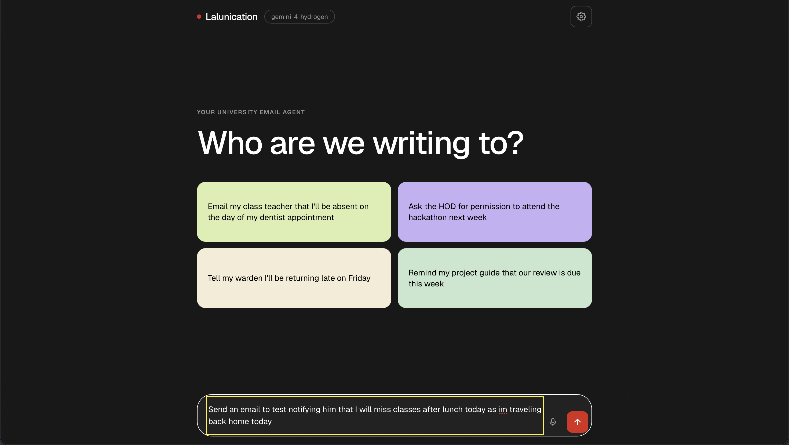
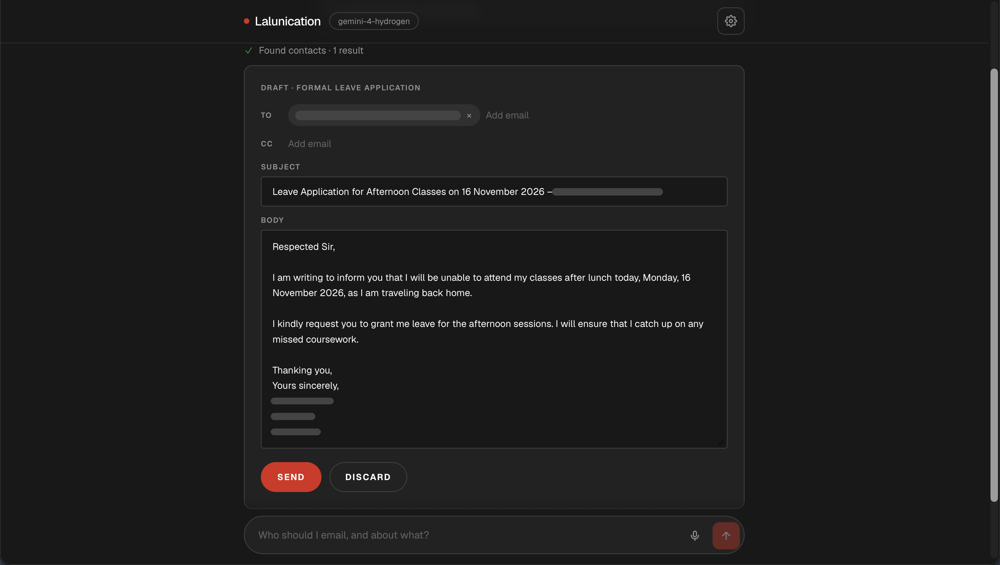
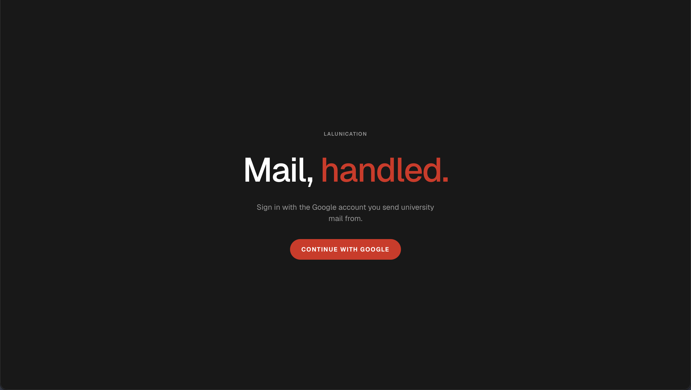
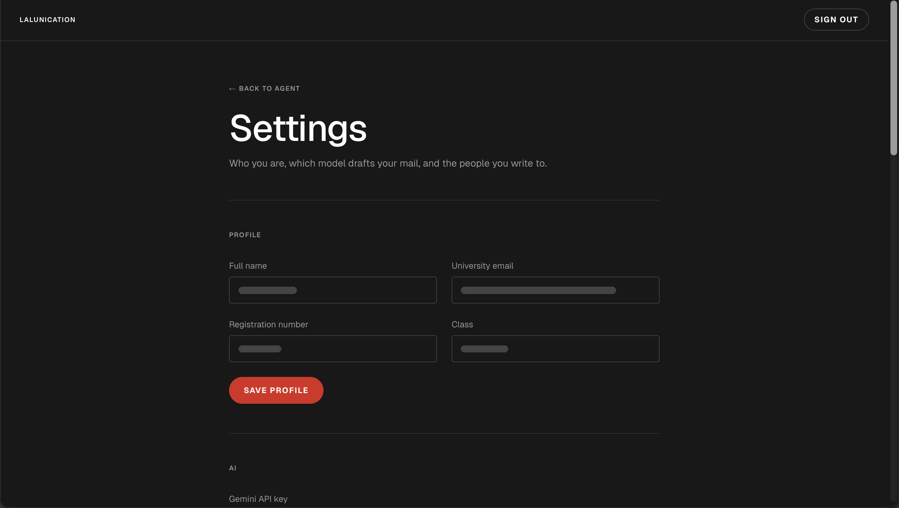

# Lalunication

**An AI agent for university email.** Tell it what you need in plain words, or say it out loud, and it figures out who to write to, finds the right dates in your calendars, writes the email in the right tone, and puts a draft on screen for you to approve. Nothing is sent until you press **Send**.

> "Email my class teacher that I'll be absent on the day of my dentist appointment."

Lalunication looks up who your class teacher is, finds "dentist" in your calendar, writes a formal leave application with your name, registration number and class, and shows you the draft.

<p align="center">
  
</p>

## Why

Most university email goes to the same handful of people: your class teacher, subject teachers, the HOD, the warden. Every time, you have to look up their address, work out the right level of formality, and dig through your calendar for the date. Lalunication remembers the people and their roles, checks your calendars for you, and writes the email properly.

## Features

- **Chat to email.** Describe the email by typing or speaking. The agent works out the recipient, the date, the type of message and the tone.
- **Recipients by role.** Save people once with roles like *class teacher*, *HOD*, *warden* or *subject teacher: maths*, then just say "my HOD".
- **Finds dates for you.** Looks in **Google Calendar**, then **Apple Calendar** (iCloud), then **Google Tasks**, then **Apple Reminders**, and stops at the first match. The draft shows where each date came from.
- **The right tone.** Recognises the kind of message (leave application, request, apology, information, query, thanks) and adjusts the formality to the recipient: formal for the HOD and warden, polite and professional for teachers. Each email gets a clear subject and is signed with your name, registration number and class.
- **You approve every email.** The draft is fully editable (To, Cc, subject and body). The AI can't send anything itself; only your click on **Send** goes to Gmail.
- **Speech to text.** A mic in the message box transcribes you live (Chrome, Edge and Safari).
- **Notifications.** If you've switched to another tab when a draft is ready, you get a browser notification.
- **Pick your model.** Choose any Gemini model your key can use, and set the thinking level (Off, Low, Medium or High).
- **Multi-user.** Anyone with an account on the university's Google domain can sign in. Each person's profile, contacts, keys and reminders are kept separate.

<p align="center">
  
</p>

## How it works

```
You: "Email my class teacher I'll miss classes after lunch today"
   │
   ▼
Gemini agent (AI SDK, multi-step tool calls)
   ├─ find_contacts(role: "class teacher")         → Neon Postgres (your contacts)
   ├─ search_google_calendar / search_apple_calendar
   ├─ search_google_tasks / search_apple_reminders  (only if the date is needed)
   └─ draft_email(to, subject, body, tone)         → rendered as an editable card
   │
   ▼
You review and press Send → POST /api/send → Gmail API (your account)
```

- **Google:** you sign in with Google, which also gives the app permission to *send* Gmail and to *read* your Calendar and Tasks. It can't read your inbox.
- **Apple Calendar:** read over iCloud CalDAV using an app-specific password.
- **Apple Reminders:** Apple has no web API for Reminders, so an **Apple Shortcut** on your iPhone or Mac sends them to the app on a schedule, using a personal sync token.

<table>
  <tr>
    <td width="50%"></td>
    <td width="50%"></td>
  </tr>
  <tr>
    <td align="center"><sub>Sign in with your university Google account</sub></td>
    <td align="center"><sub>Settings: profile, AI model, contacts, calendars</sub></td>
  </tr>
</table>

## Tech stack

| | |
|---|---|
| Framework | Next.js 16 (App Router, Cache Components), React 19, TypeScript |
| AI | AI SDK v7 with `@ai-sdk/google` (Gemini) |
| Auth | Auth.js v5, Google OAuth with refresh tokens |
| Database | Neon Postgres (`@neondatabase/serverless`), via the Vercel Marketplace |
| Calendars | Google Calendar and Tasks REST APIs; iCloud CalDAV through `tsdav` |
| Styling | Tailwind CSS v4. Design: Ferrari colours on Figma-style shapes, with squircle icons and gentle motion that respects reduced-motion settings |
| Hosting | Vercel |

## Running it yourself

### 1. Install

```bash
git clone https://github.com/ethuuuu/lalunication.git
cd lalunication
npm install
```

### 2. Database

Create a Postgres database (for example `vercel integration add neon`, or any Neon project), put its `DATABASE_URL` in `.env.local`, then run:

```bash
npm run db:migrate
```

### 3. Google OAuth

1. In [Google Cloud Console](https://console.cloud.google.com), enable the **Gmail API**, **Google Calendar API** and **Google Tasks API**.
2. Set up the OAuth consent screen. Choose **Internal** if the project belongs to your university's Google organisation; otherwise choose **External** in *Testing* mode and add each user under Test users.
3. Create an OAuth client of type **Web application**. Leave the "AI agent" option unticked. Add these redirect URIs:
   - `http://localhost:3000/api/auth/callback/google`
   - `https://<your-domain>/api/auth/callback/google`

### 4. Environment variables (`.env.local`, and in Vercel)

| Variable | Required | Purpose |
|---|---|---|
| `DATABASE_URL` | ✅ | Neon or Postgres connection string |
| `AUTH_SECRET` | ✅ | Random secret for signing sessions and encrypting saved keys (`openssl rand -base64 32`) |
| `AUTH_GOOGLE_ID` / `AUTH_GOOGLE_SECRET` | ✅ | The OAuth client from step 3 |
| `ALLOWED_EMAIL` | ✅ | The owner's email. Sign-ins are limited to this email's domain |
| `ALLOWED_DOMAIN` | | Widens sign-in to a parent domain, e.g. `uni.edu` to also allow `*.uni.edu` |
| `GOOGLE_GENERATIVE_AI_API_KEY` | | The owner's backup Gemini key (other users add their own in Settings) |
| `ICLOUD_USERNAME` / `ICLOUD_APP_PASSWORD` | | The owner's backup iCloud login for Apple Calendar |

### 5. Run

```bash
npm run dev
```

Open http://localhost:3000, sign in, then go to **Settings** to add your profile, Gemini key ([get one here](https://aistudio.google.com/apikey)), contacts and, optionally, your iCloud details and the Reminders Shortcut.

## Security and privacy

- **Restricted sign-in.** Only verified Google Workspace accounts on the allowed domain can sign in. Personal Google accounts that use a university email address are rejected.
- **Separate data.** Every database query is limited to the signed-in user.
- **Encrypted secrets.** Gemini keys and iCloud passwords are encrypted (AES-256-GCM) before they're stored. Reminders sync tokens are stored only as SHA-256 hashes.
- **Minimal Google access.** The app can send Gmail but can't read your inbox; Calendar and Tasks are read-only.
- **You send, not the AI.** The model can only *draft*; sending requires your click.
- **Database code stays on the server.** The database module is marked `server-only`, so the build fails if browser code ever imports it.

## Tests

```bash
node --experimental-strip-types scripts/access.test.mjs    # sign-in domain rules
node --experimental-strip-types scripts/sources.test.mjs   # iCal parsing, RFC 2822/2047 email encoding
AUTH_SECRET=x node --experimental-strip-types scripts/crypto.test.mjs
```

## Known limitations

- Notifications only work while the tab is open. Notifications after closing it would need Web Push.
- Repeating Apple Calendar events only show their first occurrence.
- Speech-to-text isn't available in Firefox, which doesn't support the Web Speech API.
- Each user needs their own Gemini API key; a shared app key with usage limits is planned.
